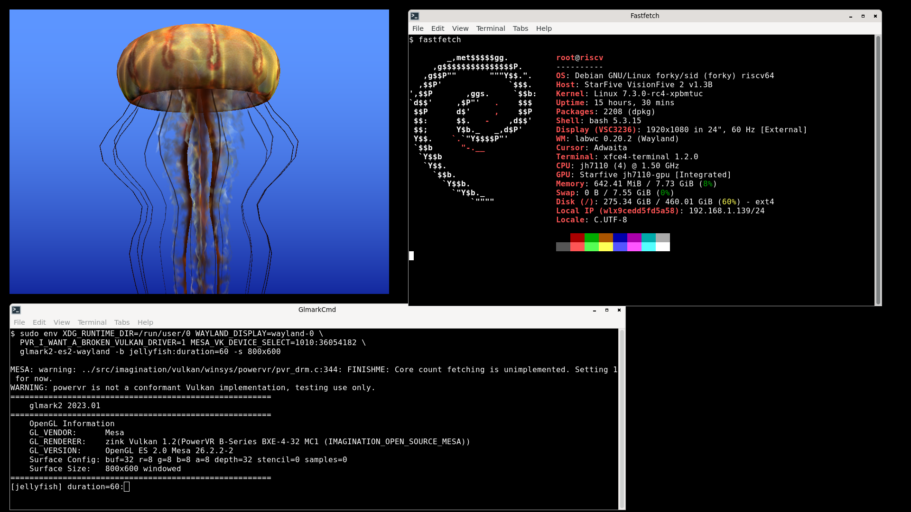
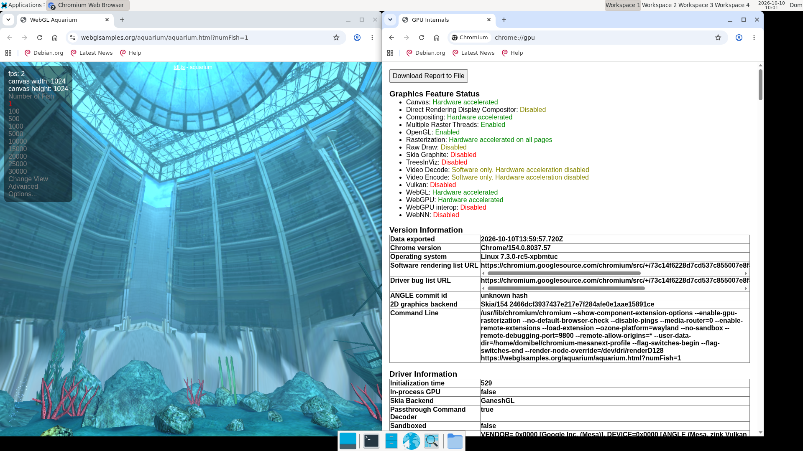

# JH7110 / VisionFive 2 - PowerVR BXE-4-32 GPU + DC8200 display bring-up





Chromium 154.0.8037.57 (Sep 2026) with WebGL hardware accelerated.

## Summary

With a few small kernel changes you can get a working GPU-composited desktop on the StarFive VisionFive 2.

- StarFive VisionFive 2 (SoC: JH7110)
- GPU: Imagination PowerVR BXE-4-32 (BVNC `36.50.54.182`)
- Firmware: FW version v1.1 (build 6976702 OS)
- Mesa 26.3.0-rc1: Vulkan 1.2, OpenGL 3.2, OpenGL ES 3.1 (OpenGL via Zink)
- CPU: default `schedutil` cpufreq governor (not `performance`, which can increase FPS up to 2x in some scenes)

### vkmark test results

The following results are from vkmark under three configurations:
1. direct KMS scanout (no compositor, no window)
2. labwc
3. XFCE + labwc: XFCE on Wayland, with labwc as the compositor

The physical screen always runs at its native 1920x1080.

Under labwc and XFCE + labwc, `vkmark` runs in a 1920x1080 or 800x600 window:

| Scene | FPS (KMS, 1920x1080) | FPS (labwc, 1920x1080) | FPS (XFCE + labwc, 1920x1080) | FPS (labwc, 800x600) | FPS (XFCE + labwc, 800x600) |
|---|---|---|---|---|---|
| clear | 469 | 63 | 59 | 201 | 221 |
| cube | 159 | 32 | 31 | 159 | 171 |
| shading | 92 | 26 | 21 | 72 | 71 |
| desktop | 22 | 11 | 8 | 41 | 38 |
| effect2d | 9 | 7 | 5 | 21 | 21 |
| texture | 84 | 23 | 20 | 95 | 97 |
| vertex | 132 | 31 | 28 | 98 | 101 |

Command line invocation and output:

- [`vkmark_7scenes_kms_mesa26.3.0-rc1_1920x1080_20sec_output.txt`](vkmark_7scenes_kms_mesa26.3.0-rc1_1920x1080_20sec_output.txt)
- [`vkmark_7scenes_labwc_mesa26.3.0-rc1_1920x1080_20sec_output.txt`](vkmark_7scenes_labwc_mesa26.3.0-rc1_1920x1080_20sec_output.txt)
- [`vkmark_7scenes_labwc_mesa26.3.0-rc1_800x600_20sec_output.txt`](vkmark_7scenes_labwc_mesa26.3.0-rc1_800x600_20sec_output.txt)
- [`vkmark_7scenes_xfce_labwc_mesa26.3.0-rc1_1920x1080_20sec_output.txt`](vkmark_7scenes_xfce_labwc_mesa26.3.0-rc1_1920x1080_20sec_output.txt)
- [`vkmark_7scenes_xfce_labwc_mesa26.3.0-rc1_800x600_20sec_output.txt`](vkmark_7scenes_xfce_labwc_mesa26.3.0-rc1_800x600_20sec_output.txt)


### glmark2-es2-wayland test results

The following results are from glmark2-es2-wayland (OpenGL ES via Zink) under
two configurations:
1. labwc
2. XFCE + labwc: XFCE on Wayland, with labwc as the compositor

The physical screen always runs at its native 1920x1080.

`glmark2` runs in a 1920x1080 or 800x600 window:

| Scene | FPS (labwc, 1920x1080) | FPS (XFCE + labwc, 1920x1080) | FPS (labwc, 800x600) | FPS (XFCE + labwc, 800x600) |
|---|---|---|---|---|
| clear | 21 | 24 | 64 | 69 |
| shading | 18 | 17 | 41 | 41 |
| bump | 18 | 20 | 51 | 60 |
| function | 16 | 13 | 41 | 47 |
| texture | 18 | 19 | 45 | 59 |
| ideas | 11 | 10 | 14 | 14 |
| shadow | 5 | 5 | 13 | 14 |
| pulsar | 13 | 11 | 41 | 40 |
| refract | 3 | 3 | 5 | 5 |
| conditionals | 13 | 13 | 44 | 45 |
| effect2d | 10 | 8 | 39 | 39 |
| loop | 14 | 9 | 37 | 36 |
| buffer | 9 | 10 | 20 | 21 |
| desktop | 3 | 3 | 9 | 9 |
| terrain | 1 | 1 | 2 | 2 |
| build | 18 | 20 | 45 | 55 |
| jellyfish | 5 | 5 | 15 | 15 |

Command line invocation and output, e.g.:

- [`glmark2_jellyfish_labwc_zink_mesa26.3.0-rc1_1920x1080_20sec_output.txt`](glmark2_jellyfish_labwc_zink_mesa26.3.0-rc1_1920x1080_20sec_output.txt)
- [`glmark2_jellyfish_xfce_labwc_zink_mesa26.3.0-rc1_1920x1080_20sec_output.txt`](glmark2_jellyfish_xfce_labwc_zink_mesa26.3.0-rc1_1920x1080_20sec_output.txt)

### glxgears test results

`glxgears` renders under labwc at 30 FPS via Xwayland, with OpenGL translated
to Vulkan by Zink.

- [`glxgears_labwc_xwayland_zink_mesa26.3.0-rc1_output.txt`](glxgears_labwc_xwayland_zink_mesa26.3.0-rc1_output.txt)

## Firmware

The driver loads `rogue_36.50.54.182_v1.fw` from `/lib/firmware/powervr/`.
Pinned to commit `8a58f818` (`FW version v1.1 (build 6976702 OS)`).

Install:

```bash
wget https://gitlab.freedesktop.org/imagination/linux-firmware/-/raw/8a58f81883f7be458daa34e418cc4079f995b279/powervr/rogue_36.50.54.182_v1.fw

sudo mkdir -p /lib/firmware/powervr
sudo cp rogue_36.50.54.182_v1.fw /lib/firmware/powervr/
```

## Kernel

You need to merge 2 branches into your kernel:

[`jh7110_dc8200_hdmi_v7.3-rc5`](https://github.com/domibel/linux/tree/jh7110_dc8200_hdmi_v7.3-rc5)
and
[`powervr_on_jh7110_visionfive2_v7.3-rc5`](https://github.com/domibel/linux/tree/powervr_on_jh7110_visionfive2_v7.3-rc5)

```bash
git remote add domibel https://github.com/domibel/linux
git fetch domibel powervr_on_jh7110_visionfive2_v7.3-rc5 jh7110_dc8200_hdmi_v7.3-rc5
git checkout -b test_gpu v7.3-rc5
git merge domibel/powervr_on_jh7110_visionfive2_v7.3-rc5
git merge domibel/jh7110_dc8200_hdmi_v7.3-rc5
```

and additionally, the following config options:

```
CONFIG_DRM_POWERVR=m
CONFIG_DRM_VERISILICON_DC=y
CONFIG_CMA=y
CONFIG_ERRATA_SIFIVE=y
CONFIG_ERRATA_SIFIVE_XPBMTUC=y
CONFIG_STARFIVE_STARLINK_CACHE=y  # hack: only way to pull in RISCV_NONSTANDARD_CACHE_OPS below
CONFIG_RISCV_NONSTANDARD_CACHE_OPS=y
CONFIG_DRM_STARFIVE_JH7110_INNO_HDMI=y
CONFIG_PHY_STARFIVE_JH7110_INNO_HDMI=y
CONFIG_SOC_STARFIVE_JH7110_VOUT_SUBSYSTEM=y
CONFIG_SOC_STARFIVE_JH7110_HDMI_SUBSYSTEM=y
```

The display/HDMI ones are `=y` (built-in) rather than `=m` so the framebuffer
console comes up early enough to show kernel boot messages on screen.
The GPU driver itself stays a module.

Append them to your `.config`, then run:

```bash
make ARCH=riscv olddefconfig
```

The DTB
`arch/riscv/boot/dts/starfive/jh7110-starfive-visionfive-2-v1.3b.dtb` is
built from the same tree. Where it needs to go depends on how your board's
bootloader is set up, on my system it's `/boot/efi/dtb/starfive/`.

[`visionfive2-live.dts`](visionfive2-live.dts) is the actual devicetree my
kernel runs with, dumped with:

```bash
sudo dtc -I fs -O dts -o visionfive2-live.dts /sys/firmware/devicetree/base
```

Compare your own against it if something isn't probing right.
I tested this with U-Boot 2025.01-3 (Debian-packaged) and 2026.07.

If your kernel's default CMA reservation is too small, increase it with
`cma=128M` or higher on your kernel cmdline. `cma=64M` can fail with
`fbdev: Failed to setup emulation (ret=-12)` and no HDMI output at all.

## Load the driver to create the GPU node /dev/dri/renderD128

It may already be loaded at boot (nothing blacklists it by default).
```bash
sudo modprobe powervr
```

Check that it's loaded:
```bash
lsmod | grep powervr
```

```
powervr               720896  0
drm_gpuvm             131072  1 powervr
gpu_sched             217088  1 powervr
drm_exec               24576  2 drm_gpuvm,powervr
drm_shmem_helper       98304  1 powervr
```

## Add the user to `render` group to grant access to /dev/dri/renderD128

Check whether you can already read and write the device node:

```bash
test -r /dev/dri/renderD128 -a -w /dev/dri/renderD128 && echo "can access" || echo "cannot access"
```

If this prints "cannot access", add yourself to the `render` group (the group that owns the device node):

```bash
sudo usermod -aG render $USER
```

Log out and back in (group membership needs a new login session), then check again.

## Install userspace packages

```bash
sudo apt install mesa-vulkan-drivers mesa-utils vulkan-tools vkmark glmark2-es2-wayland labwc
```

## Vulkan and OpenGL driver info

Every GPU program needs two environment variables:
`PVR_I_WANT_A_BROKEN_VULKAN_DRIVER=1` (Mesa refuses to load its non-conformant
BXE-4-32 driver without it) and `MESA_VK_DEVICE_SELECT=1010:36054182`
(`vendorID:deviceID`, `36054182` comes from the BVNC `36.50.54.182`), which
selects the GPU instead of llvmpipe.

Vulkan:

```bash
export PVR_I_WANT_A_BROKEN_VULKAN_DRIVER=1 MESA_VK_DEVICE_SELECT=1010:36054182
vulkaninfo --summary
```

```
...
Devices:
========
GPU0:
	apiVersion         = 1.2.363
	driverVersion      = 26.3.0
	vendorID           = 0x1010
	deviceID           = 0x36054182
	deviceType         = PHYSICAL_DEVICE_TYPE_INTEGRATED_GPU
	deviceName         = PowerVR B-Series BXE-4-32 MC1
	driverID           = DRIVER_ID_IMAGINATION_OPEN_SOURCE_MESA
	driverName         = Imagination open-source Mesa driver
	driverInfo         = Mesa 26.3.0-rc1 (git-4706512989)
	conformanceVersion = 1.4.3.3
	deviceUUID         = 24b1ada6-eb24-5172-55c6-fa2b276f833d
	driverUUID         = 27bd0902-2c43-66c3-c3a6-58db64a7eddb
GPU1:
	apiVersion         = 1.4.363
	driverVersion      = 26.3.0
	vendorID           = 0x10005
	deviceID           = 0x0000
	deviceType         = PHYSICAL_DEVICE_TYPE_CPU
	deviceName         = llvmpipe (LLVM 21.1.8, 128 bits)
	driverID           = DRIVER_ID_MESA_LLVMPIPE
	driverName         = llvmpipe
	driverInfo         = Mesa 26.3.0-rc1 (git-4706512989) (LLVM 21.1.8)
	conformanceVersion = 1.3.1.1
	deviceUUID         = 6d657361-3236-2e33-2e30-2d7263310000
	driverUUID         = 6c6c766d-7069-7065-5555-494400000000
```

OpenGL/GLES (via Zink):

```bash
eglinfo -B -p surfaceless
```

```
MESA: warning: ../src/imagination/vulkan/winsys/powervr/pvr_drm.c:344: FINISHME: Core count fetching is unimplemented. Setting 1 for now.
WARNING: powervr is not a conformant Vulkan implementation, testing use only.
Surfaceless platform:
EGL API version: 1.5
EGL vendor string: Mesa Project
EGL version string: 1.5
EGL client APIs: OpenGL OpenGL_ES
OpenGL core profile vendor: Mesa
OpenGL core profile renderer: zink Vulkan 1.2(PowerVR B-Series BXE-4-32 MC1 (IMAGINATION_OPEN_SOURCE_MESA))
OpenGL core profile version: 3.2 (Core Profile) Mesa 26.3.0-rc1 (git-4706512989)
OpenGL core profile shading language version: 1.50
OpenGL compatibility profile vendor: Mesa
OpenGL compatibility profile renderer: zink Vulkan 1.2(PowerVR B-Series BXE-4-32 MC1 (IMAGINATION_OPEN_SOURCE_MESA))
OpenGL compatibility profile version: 3.2 (Compatibility Profile) Mesa 26.3.0-rc1 (git-4706512989)
OpenGL compatibility profile shading language version: 1.50
OpenGL ES profile vendor: Mesa
OpenGL ES profile renderer: zink Vulkan 1.2(PowerVR B-Series BXE-4-32 MC1 (IMAGINATION_OPEN_SOURCE_MESA))
OpenGL ES profile version: OpenGL ES 3.1 Mesa 26.3.0-rc1 (git-4706512989)
OpenGL ES profile shading language version: OpenGL ES GLSL ES 3.10
```

## Run under XFCE on Wayland + labwc

```bash
sudo apt install xfce4 labwc lightdm
mkdir -p ~/.config/xfce4/labwc
cp -n /usr/share/xfce4/labwc/labwc-environment ~/.config/xfce4/labwc/environment
echo WLR_RENDER_DRM_DEVICE=/dev/dri/renderD128 >> ~/.config/xfce4/labwc/environment
```

Load `powervr` before you log in, then select **Xfce Session (Wayland)** on the login screen.

In a terminal:

```bash
export PVR_I_WANT_A_BROKEN_VULKAN_DRIVER=1 MESA_VK_DEVICE_SELECT=1010:36054182
glmark2-es2-wayland -s 1920x1080 -b jellyfish:duration=20
```

## Run vkmark (headless, KMS or Wayland)

```bash
export PVR_I_WANT_A_BROKEN_VULKAN_DRIVER=1 MESA_VK_DEVICE_SELECT=1010:36054182

# headless - no root needed
vkmark --winsys headless -s 1920x1080 \
  -b clear:duration=20 -b cube:duration=20 -b shading:duration=20 \
  -b desktop:duration=20 -b effect2d:duration=20 -b texture:duration=20 \
  -b vertex:duration=20

# kms - needs root
# Stop your display manager first, e.g.
# `sudo systemctl stop lightdm`
sudo env PVR_I_WANT_A_BROKEN_VULKAN_DRIVER=1 MESA_VK_DEVICE_SELECT=1010:36054182 \
vkmark --winsys kms --winsys-options kms-tty=/dev/tty1 -s 1920x1080 \
  -b clear:duration=20 -b cube:duration=20 -b shading:duration=20 \
  -b desktop:duration=20 -b effect2d:duration=20 -b texture:duration=20 \
  -b vertex:duration=20

# wayland - inside a running labwc or XFCE on Wayland + labwc session
vkmark --winsys wayland -s 1920x1080 \
  -b clear:duration=20 -b cube:duration=20 -b shading:duration=20 \
  -b desktop:duration=20 -b effect2d:duration=20 -b texture:duration=20 \
  -b vertex:duration=20
```

## Run under labwc (Wayland compositor)

Run this from a real console/TTY, not a terminal inside an existing X11 or
Wayland desktop session — a stray `DISPLAY`/`WAYLAND_DISPLAY` makes wlroots
nest inside that session instead of using DRM/KMS directly.

```bash
sudo env XDG_RUNTIME_DIR=/run/user/0 XDG_SEAT=seat0 \
  WLR_LIBINPUT_NO_DEVICES=1 WLR_RENDER_DRM_DEVICE=/dev/dri/renderD128 \
  PVR_I_WANT_A_BROKEN_VULKAN_DRIVER=1 MESA_VK_DEVICE_SELECT=1010:36054182 \
  labwc
```

```bash
sudo env XDG_RUNTIME_DIR=/run/user/0 WAYLAND_DISPLAY=wayland-0 \
  PVR_I_WANT_A_BROKEN_VULKAN_DRIVER=1 MESA_VK_DEVICE_SELECT=1010:36054182 \
  glmark2-es2-wayland -s 1920x1080 -b jellyfish:duration=20
```

Or just run [`run_labwc_jellyfish.sh`](run_labwc_jellyfish.sh), which does both steps above,
checks for the common failure modes (stray `DISPLAY`, another display server already
running) with a clear error message, and cleans up after itself.

## Chromium

WebGL runs on the GPU (ANGLE → Zink → PowerVR), at about 2 fps in the
[WebGL Aquarium](https://webglsamples.org/aquarium/aquarium.html?numFish=1).
Needs a riscv64 Chromium build (Debian has none yet, see Issues).

Run it as your user from a terminal inside the XFCE on Wayland + labwc session:

```bash
export PVR_I_WANT_A_BROKEN_VULKAN_DRIVER=1 MESA_VK_DEVICE_SELECT=1010:36054182
chromium --ozone-platform=wayland --no-sandbox \
  "https://webglsamples.org/aquarium/aquarium.html?numFish=1"
```

`--no-sandbox` is required; with the sandbox every tab crashes.

For comparison, the StarFive vendor stack (kernel `6.12.5-starfive`, closed
`img-gpu` GLES driver, Chromium 142, labwc) runs the same Aquarium at 32 fps
([forum thread](https://forum.rvspace.org/t/chromium-hardware-acceleration-on-vf2/6167/3?u=lzzhzh)).

## WebGPU via Dawn

You can also use the GPU through WebGPU:

```bash
sudo apt install dawn-tools libwebgpu-dawn-dev
```

The Mesa pvr driver does not meet all WebGPU requirements yet.
`DEBIAN_DAWN_RAISE_LIMITS=1` makes Dawn accept the GPU anyway. Programs that
go beyond the real hardware limits may crash or render incorrectly.

```bash
export PVR_I_WANT_A_BROKEN_VULKAN_DRIVER=1 MESA_VK_DEVICE_SELECT=1010:36054182
export DEBIAN_DAWN_RAISE_LIMITS=1
<your dawn program>
```


To find bugs in the pvr Mesa driver, run Dawn's end-to-end tests:

```bash
export PVR_I_WANT_A_BROKEN_VULKAN_DRIVER=1 MESA_VK_DEVICE_SELECT=1010:36054182
export DEBIAN_DAWN_RAISE_LIMITS=1
dawn_end2end_tests --backend=vulkan --exclusive-device-type-preference=integrated \
  --gtest_filter='BasicTests.*' --gtest_brief=1
```

```
 - "PowerVR B-Series BXE-4-32 MC1" - "Imagination open-source Mesa driver: Mesa 26.3.0-rc1 (git-4706512989) [Selected]"
...
[==========] 6 tests from 1 test suite ran. (836 ms total)
[  PASSED  ] 5 tests.
[  SKIPPED ] 1 test.
```

Full output: [`dawn_end2end_tests_BasicTests_mesa26.3.0-rc1_output.txt`](dawn_end2end_tests_BasicTests_mesa26.3.0-rc1_output.txt)

To run all tests, run each suite in its own process (two suites crash and
would end a single run); this takes about 45 minutes:

```bash
dawn_end2end_tests --backend=vulkan --exclusive-device-type-preference=integrated \
  --gtest_list_tests | grep -E '^[A-Za-z0-9_/]+\.$' | while read -r s; do
  dawn_end2end_tests --backend=vulkan --exclusive-device-type-preference=integrated \
    --gtest_filter="${s}*" --gtest_brief=1
done
```

Full run (all 259 suites, 10354 tests, Mesa 26.3.0-rc1): 4367 passed, 5690
skipped, 273 failed, 2 suites crashed. Per suite:
[`dawn_end2end_tests_all_suites_mesa26.3.0-rc1_summary.txt`](dawn_end2end_tests_all_suites_mesa26.3.0-rc1_summary.txt).

<details>
<summary>Failing tests (number of failing variants)</summary>

| Suite | Failing tests |
|---|---|
| `BindGroupTests` | `BindGroupsPersistAfterPipelineChange`, `DrawThenChangePipelineAndBindGroup`, `DrawThenChangePipelineTwiceAndBindGroup`, `SetDynamicBindGroupBeforePipeline` (1 each) |
| `CompressedTextureFormatTest` | `CopyMultiple2DArrayLayers`, `CopyWhole2DArrayTexture`, `CopyWithMultipleLayerAndPhysicalSizeNotEqualToVirtualSize`, `Cube` (20 each; GPU page faults) |
| `CompressedTextureWriteTextureTest` | `WriteMultiple2DArrayLayers` (10) |
| `ComputeSharedMemoryTests` | `AssortedTypes` (2) |
| `DepthTextureClearTwiceTest` | `ClearDepthAspectTwice` (30) |
| `MultisampledRenderingTest` | `ResolveIntoMultipleResolveTargetsWithAlphaToCoverage` (3), `ResolveIntoMultipleResolveTargetsWithShaderOutputMask` (3) |
| `RuntimeTimeoutComputeTest` | `LargeConstantArrayInLoop` (1) |
| `TextureSampleCompare2DTest` | `Compare2D` (2) |
| `TextureZeroInitTest` | `IndependentDepthStencilCopyAfterDiscard` (1) |
| `VideoViewsTests` | crashes (segfault) |
| `VideoViewsValidationTests` | `CreateYUVAViewValidation`, `CreateYUVViewValidation` (1 each), then crashes (segfault) |
| `VideoViewsExtendedUsagesTests` | `SamplingMultiPlanarYUVTexture` (1) |
| `Vulkan/SharedTextureMemoryTests` | 35 tests (2 each) |
| `VulkanImageWrappingUsageTests` | 11 tests (4 each) |
| `VulkanImageWrappingValidationTests` | `DestroyedTextureSignalSemaphoreExport`, `DoubleSignalSemaphoreExport`, `SuccessfulImport`, `SuccessfulImportWithInternalUsageDescriptor` (4 each) |
| `VulkanImageWrappingMultithreadTests` | `WrapAndClear_OnMultipleThreads` (4) |

</details>

With ASTC enabled
([mesa!44008](https://gitlab.freedesktop.org/mesa/mesa/-/merge_requests/44008),
not merged yet), three suites differ:

- `CompressedTextureFormatTest`: +784 passed, +224 failed
- `CompressedTextureWriteTextureTest`: +56 passed, +28 failed
- `UnalignedCompressedTextureFormatTest`: +56 passed, 0 failed

## Acknowledgments

Thanks to everyone whose upstream work and advice made this possible, especially:

- Michal Wilczynski
- Icenowy Zheng
- Bo Gan
- Samuel Holland
- Alessio Belle
- Simon Perretta
- Frank Binns

## Issues

- Need more user feedback
- Debian has no riscv64 Chromium build - https://buildd.debian.org/status/package.php?p=chromium
- My custom Chromium build took 2 weeks - https://salsa.debian.org/domibel/chromium/-/tree/riscv64-support
- Need better riscv64 hardware to build heavy packages, any companies listening ?
